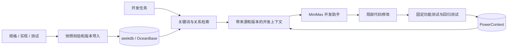

# 一页技术说明

目标：根据开发任务，向助手提供当前有效的规格、相关实现、功能及回归测试，并保存可以跨进程使用的任务进展。

**资料和版本。** `project.json` 声明工程边界。规格来自 JSON 条目，代码和测试通过 Python AST 提取符号及行号。所有路径经真实路径解析并限制在工程内。资料、元数据和哈希进入 seekdb 的 `sdd_documents`，按项目、资料 ID、修订号寻址。导入先验证完整快照，再在项目锁和事务中切换活跃项；历史不删除。来源变化、失效、删除与重复导入分别得到新版本、退出当前检索或保持版本。

**上下文选择。** 任务关键词通过参数化 SQL 查询当前活跃资料，再沿资料中的显式关系补齐实现与测试。每个输出条目含路径、符号、行号、版本和哈希。重读当前文件校验哈希，拒绝未重新导入的陈旧资料。样例另含失效决策和不相关发票规格，用于检查错误召回。

**模型分工。** MiniMax 官方 HTTP 文本接口接收实际检索的上下文与待办。适配器只应用白名单实现文件的有效 Python 源码，随后执行固定测试；最多三轮修复。保存请求、可见修改、用量与响应 ID，认证信息和私有思维链不写记录。独立的参考模式使用本地参考实现，并始终标明不满足真实模型参与要求。

**状态分工。** 使用 PowerContext 1.4.1 官方 Python Client 通过 HTTP 调用 `create_scope`、`remember_memory`、`get_artifact_revision`。任务内容持久保存在 `atomic-memory`；本地 pointer 仅保存地址。新的操作系统进程重新连接并读取状态，`pending` 决定后续动作。验证与规格、代码和测试的组合哈希绑定，变更后标记过期并要求重新验证。

**验证和边界。** 修改前后固定测试及夹具保持相同哈希，记录命令、退出码、源码哈希和 JUnit。演示包含实际数据库查询、空状态首次保存、新进程复用和规格升级。模块支持显式结构化资料与小型工程；不声称自动解决自然语言冲突或恢复完整 Agent 会话。当前真实 MiniMax 调用等待凭据，参考模式结果不能作为六项全通过的证据。
