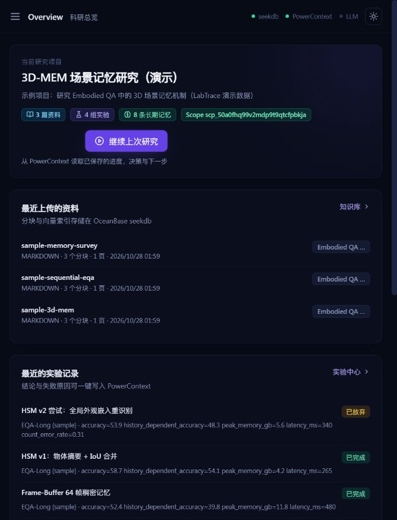

# LabTrace · AI 科研记忆工作台

检索过去的知识、理解过去的实验、恢复过去的决策，并继续当前研究。

基于 OceanBase PowerContext `2026-competition-ecosystem` 分支，全部资产位于 `qoder/`。
比赛基线：`d647275c308e09b7b623f322a26f5c4e85734fb0`。

## 已实现

- **文献知识库**：PDF / Markdown / TXT 上传、分块、页码、seekdb 关键词 / 向量 / RRF 混合检索与原文引用。
- **实验中心**：参数与 JSON 指标、实验日志、导入、对比、最优指标和失败原因检索。
- **长期记忆**：六类研究状态，PowerContext Source / Memory / Handoff，跨会话恢复、修订、停用和项目 Scope 隔离。
- **科研助手**：路由论文、实验和记忆数据源；展示实际证据与引用。未配模型时返回证据摘录。
- **科研周报**：按日期聚合实际记录，预览、编辑、复制和下载 Markdown。
- **工作台**：七个页面、深浅主题、移动导航、服务状态、明确的空态和失败提示。

| 技术 | 实际作用 |
| --- | --- |
| seekdb | 存储论文分块和实验；执行 FULLTEXT、VECTOR ANN 和项目过滤 |
| PowerContext Server 1.2.0 | 长期记忆版本、研究来源、项目隔离、会话交接 |
| FastAPI / React + TypeScript | 服务端接口和科研工作台 |

应用运行路径不使用模拟数据库或浏览器记忆替代服务。单元测试使用测试替身；真实服务测试另行验证。
无模型 API 时使用明确标注的哈希向量，它不是语义模型。远程模型配置后若发生故障会返回错误，防止混入不同向量。
切换 Embedding 模型需清理该项目原文档并重新导入，不能直接混用旧向量，即使维度相同。

## 快速启动

安装 Docker Desktop / Compose，建议至少 6 GB 可用内存。Windows 在 `qoder/` 中：

```powershell
.\scripts\start.ps1
# 默认前端 http://127.0.0.1:5173，API http://127.0.0.1:8100
```

Linux / macOS / WSL：

```bash
cd qoder
cp .env.example .env
# 在 .env 设置随机 POWERCONTEXT_AUTH_TOKEN，例如 openssl rand -hex 24
# 不要将 .env 提交到 Git
docker compose up -d --build
```

需要独立 seekdb 服务端时加 override：

```bash
docker compose -f docker-compose.yml -f docker/docker-compose.seekdb-server.yml up -d --build
```

本机已有服务使用网页 **http://127.0.0.1:15173**、API **http://127.0.0.1:18100**。
该地址只用于本地体验，不是已发布的比赛网站。
启动脚本可用 `-WebPort` 等参数初始化其他端口；已有 `.env` 值优先。
完整环境、原生 WSL 开发和模型配置见 [SETUP](docs/SETUP.md)。

## 可重复验证

```bash
cd qoder
pip install httpx
python scripts/e2e_demo.py --api http://127.0.0.1:8100 --keep
# 上传 → 检索 → 实验 → 保存记忆 → 新会话恢复 → 周报
cd backend
pip install -r requirements.txt
python -m pytest -q
# 121 passed，27 skipped（live 默认关闭）
LABTRACE_LIVE=1 LABTRACE_API_URL=http://127.0.0.1:5173 python -m pytest -q
# 148 passed（通过前端同源代理实际访问服务）
cd ../frontend
npm ci
npm run build
```

2026-10-28 本轮结果：**148 项测试通过**，A–D 演示全部通过。
原始输出与新增 PDF、记忆纠正验证见 [VERIFICATION](docs/VERIFICATION.md)。
所有文献笔记、实验数字和计划均为原创示例，不能当作真实科研结果或用户效果数据。



## 目录与交付

```text
qoder/
  backend/app/          FastAPI、seekdb、PowerContext、助手与周报
  backend/tests/        单元测试和真实服务测试
  frontend/src/         React 工作台
  docker/               镜像、Nginx、独立 seekdb override
  db/schema.sql         数据库初始化
  sample-data/          原创文档、两页 PDF、实验和示例周报
  scripts/              启动、演示、PDF 生成、站点构建、提交检查与打包
  site/                 Qoder Sites 展示站源文件
  docs/                 运行 / 架构 / 集成 / 验证 / 部署 / 开发记录
```

- [ARCHITECTURE](docs/ARCHITECTURE.md)：模块与数据流。
- [TECH_INTEGRATION](docs/TECH_INTEGRATION.md)：真实 SQL 与 PowerContext API。
- [DEPLOYMENT](docs/DEPLOYMENT.md)：Docker、Qoder Sites 和公开部署。
- [SUBMISSION](docs/SUBMISSION.md)：材料状态、自检、打包和提交方式。
- [QODER_DEVELOPMENT_LOG](docs/QODER_DEVELOPMENT_LOG.md)：已归档的 Qoder 对话原文、开发过程与代码索引；待补原始界面截图和 UID。
- [CODEX_COMPLETION_LOG](docs/CODEX_COMPLETION_LOG.md)：本次实际工程活动。
- [USER_TESTING](docs/USER_TESTING.md)：真实用户测试模板。

## 比赛状态

本地项目与技术验证可用。用户已提供 Qoder 主要开发过程的对话文本，已归档并整理到开发记录。
报名仓库为 [moxiao11/powercontext](https://github.com/moxiao11/powercontext)。
**Qoder Sites 发布、Qoder UID、原始 Qoder 对话截图 / 录屏仍待补齐**。
Qoder 的主要实现记录与 Codex 后续工程补全分开记录。
未配置真实模型 API，生成式问答和语义检索质量尚未验证；科研关联图尚未实现。
当前为本地单用户工作台，没有生产级用户鉴权，公开实例需另行配置访问控制。

展示站打包与提交自检：

```bash
python scripts/build_site.py
# 将 dist/site/ 交给个人 Qoder Sites 发布
python scripts/submission.py check
python scripts/submission.py pack
# 全部真实信息补齐后：check --strict
```
