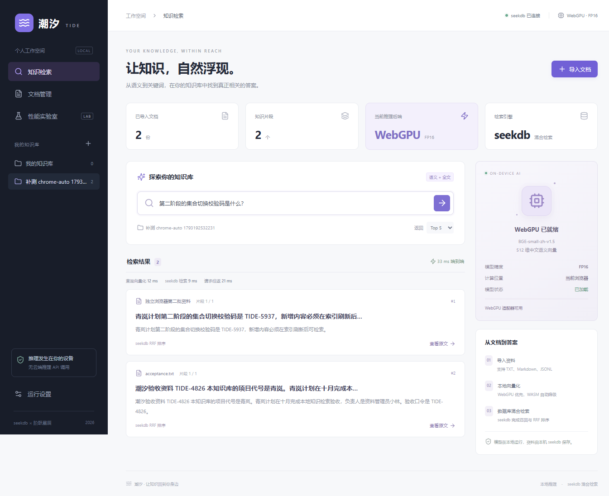

# 干净安装与首次启动验证

2026-10-28，从提交源码复制一份到独立临时目录，未复制现有 `node_modules`、`dist`、`.env` 或数据库文件；执行锁文件安装、模型校验和生产构建。原始阶段记录见 [clean-start.json](clean-start.json)。这是干净源码副本测试，不是远程 Git 克隆测试。

| 阶段 | 结果 | 范围 |
|---|---|---|
| `npm ci --no-fund --no-audit` | 通过 | 276 个依赖重新安装，postinstall 复制本地 ORT 资源；可复用 npm 下载缓存 |
| `npm run models:download` | 通过 | 复用已下载的固定模型文件作为本地模型来源；三个 ONNX 文件重新校验大小和 SHA-256，不声称重新联网下载 |
| `npm run build` | 通过 | TypeScript 检查与 Vite 生产构建 |
| `docker compose up -d --wait seekdb` | 通过 | Docker Engine 29.2.0；全新命名卷、本机 12884 端口，固定 seekdb 镜像，健康检查通过 |
| 独立生产服务 | 通过 | 本机 8790；首次 API 集合列表为空，实际 seekdb 1.4.0 |
| Chrome 可见窗口完整流程 | 通过 | 156.0.8078.73，WebGPU/FP16；8 项检查，包括导入、刷新、检索、原文、去重、增量、切库、浏览器向量与本机请求 |
| 清理 | 通过 | 测试创建的集合全部删除，仅留下首次 UI 自动创建的空默认库；临时 API 和测试容器停止 |

隔离配置仅修改 Compose 项目名、数据卷名和映射端口；服务、镜像 digest、环境配置及健康检查沿用提交配置。原应用 `stepfun-seekdb-data` 数据卷保留并恢复启动，API 返回原有知识库。

第一次启动尝试中，浏览器 8 项检查已经通过，收尾脚本误把应用自动创建的空默认库视为多余数据，断言失败。该尝试原始记录保存在 [clean-start-initial-attempt.json](clean-start-initial-attempt.json)。修正断言后使用另一个全新数据卷重跑成功，未将失败记录静默改为通过。

本机 Docker Desktop 启动曾因 `Docker/run` 和 `docker-secrets-engine` 内旧通信 socket 无法访问而失败。停止本轮失败启动进程后，将这两个临时通信目录改名备份，Docker 恢复。未恢复出厂、未删除容器数据卷，也未改应用来绕过数据库。此项属于本机环境恢复，不作为应用性能优化。

